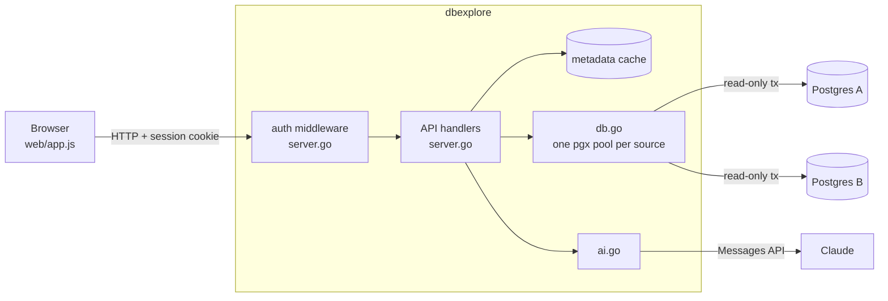

# Architecture

dbexplore is one Go binary that serves an embedded single-page UI and a small JSON API. It talks to PostgreSQL directly with [pgx](https://github.com/jackc/pgx), and optionally to the Anthropic API for Ask AI.

## Source files

| File | Responsibility |
| --- | --- |
| `main.go` | Flags (`-config`, `-print-password`, `-version`), starts the HTTP server, graceful shutdown. |
| `config.go` | Load the config, apply defaults, generate the password/secret on first start, validate sources. |
| `db.go` | Connection pools, the read-only query path, Postgres error formatting, text-to-JSON value conversion. |
| `server.go` | Routes, auth, the metadata cache and every `/api/*` handler. |
| `ai.go` | Ask AI: builds the prompt and calls Claude. |
| `web/` | The embedded UI. See [frontend.md](frontend.md). |
| `packaging/` | systemd unit and maintainer scripts for the .deb/.rpm. See [packaging.md](packaging.md). |

## Config

`loadConfig` reads the JSON file, fills in defaults and validates sources (unique ids made of `[a-zA-Z0-9_-]`, a non-empty DSN). It writes the file back only when it had to generate something (the password or the secret, or the file did not exist), so a hand-written or read-only config is never rewritten. The session cookie is an HMAC of the password keyed by the secret, so changing either logs everyone out. `no_auth` skips the middleware entirely.

## Queries

Every database call goes through `db.query(ctx, src, sql, limit, args...)`:

1. The source's pool is created on first use (`pgxpool`, at most 4 connections, idle ones closed after 5 minutes). Connections set `default_transaction_read_only=on` and `application_name=dbexplore`.
2. A transaction is opened with `AccessMode: ReadOnly`, and `statement_timeout` is set for it with `set_config(..., true)`.
3. The statement runs with `QueryExecModeDescribeExec`, i.e. the extended protocol. Postgres refuses more than one statement in a Parse message, which is what stops `select 1; delete ...`. Because `set_config` already ran, `set transaction read write` (or `set_config('transaction_read_only', 'off', true)`) fails with "must be set before any query".
4. At most `limit` rows are read. If another row is available, `has_more` is set; the paged endpoints ask for `page_size + 1` rows in SQL for exactly that reason.
5. The transaction is always rolled back.

The free-SQL endpoint additionally only accepts statements starting with `SELECT`, `WITH`, `VALUES`, `TABLE`, `EXPLAIN` or `SHOW`. Paged ones (the first four) are wrapped as `select * from (<sql>\n) q limit .. offset ..`; the newline ends a trailing `--` comment. WHERE and ORDER BY text from the table bars is pasted into SQL as-is: that is the point of the feature, and the read-only transaction plus single-statement rule are what keep it safe.

None of this replaces a read-only database role (see the README), since some functions (`pg_terminate_backend`, file access for superusers) work in read-only transactions.

### Values

Results are requested in text format for every column (`QueryResultFormatsByOID{}`), so any type, including extension types, comes back as Postgres prints it. `textValue` then maps by type OID:

| Postgres type | JSON |
| --- | --- |
| `bool` | `true` / `false` |
| `int2`, `int4`, `oid` | number |
| `int8`, `numeric`, `float4`, `float8` | number, or a string if it has more than 15 significant digits or is `NaN`/`Infinity` (JavaScript numbers are doubles) |
| `json`, `jsonb` | the JSON value itself |
| everything else | string, as Postgres formats it |
| NULL | `null` |

### Errors

Postgres errors become 400 responses with the message, detail, hint and position, shown verbatim in the UI. A timeout becomes "query timed out". Anything else (the database unreachable) is a 502 and is logged.

## Metadata

The tree (`pg_class` + `pg_namespace`), columns (`pg_attribute` + the primary key from `pg_index`), foreign keys (`pg_constraint`, multi-column aware) and the AI schema summary (`information_schema.columns`) are cached in memory for 10 minutes. The tree's ⟳ button passes `refresh=1` to reload it. Relation names in catalog queries are passed as `$1::regclass` parameters, quoted with `qi`.

## Ask AI

`ai.go` sends one Messages API request with:

- a system prompt asking for exactly one read-only statement, followed by `ai.context` and the schema summary (`schema.table(column type, ...)` per line). The system prompt is marked for prompt caching, since it is the same for every request against a source;
- the user's request, the console's current SQL (so "add a filter on X" works) and the open table, if any.

Markdown fences are stripped from the reply. The frontend puts the SQL in the editor and runs it. Only the schema and the prompt leave the server, never row data.

## HTTP API

All endpoints except `/login`, `/login.html` and `/favicon.svg` need the session cookie; API calls without it get a 401, which the UI turns into a redirect to the login page.

| Endpoint | What |
| --- | --- |
| `POST /login` | Form field `password`. Sets the cookie. |
| `GET /api/sources` | `[{id, label, ai}]` |
| `GET /api/tree?src=&refresh=` | `{schemas: [{name, tables: [{name, kind, est}]}]}`. `kind` is the `relkind`, `est` the planner's row estimate (-1 if never analyzed). |
| `GET /api/columns?src=&schema=&table=` | `[{name, type, notnull, pk}]` |
| `GET /api/fks?src=&schema=&table=` | `[{name, cols, ref_schema, ref_table, ref_cols}]` |
| `GET /api/ddl?src=&schema=&table=` | `{ddl}` |
| `POST /api/table` | `{src, schema, table, where, order, page, page_size}` → result |
| `POST /api/count` | `{src, schema, table, where}` → `{count}` |
| `POST /api/query` | `{src, sql, page, page_size}` → result |
| `POST /api/assist` | `{src, prompt, current_sql, table}` → `{sql}` |

A result is `{columns, rows, has_more, ms, sql}`. Errors are `{error}` with a 4xx/5xx status.
